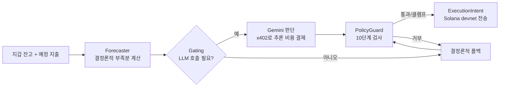

# TreAgent

> **AI가 정책 범위 안에서 직접 자금을 집행하는 Solana 트레저리 에이전트**

Web3 조직의 여러 온체인 지갑을 감시하다가, 예정된 급여·벤더 결제에 잔고가 모자랄 것 같으면
부족분을 미리 계산해 Treasury Vault에서 USDC를 옮겨 둡니다.
LLM은 판단만 하고, 실제 집행은 **PolicyGuard의 10단계 검사를 통과한 것만** 나갑니다.

<!-- 데모 GIF 또는 대시보드 스크린샷 (예: docs/demo.gif) -->
https://github.com/user-attachments/assets/b792b4a5-f2e0-4e9c-aebe-990a02f6aea7

<!-- 🏆 해커톤 이름 · 수상 여부 -->
`1인 개발` · `2026.08.01 – 08.03` · `Python` `FastAPI` `React` `TypeScript` `Solana` `Gemini` `x402`

---

## 예시

급여 지갑에 3,200 USDC가 있는데 38시간 뒤 28,000 USDC 급여 지급이 잡혀 있다면:

1. **Forecaster**가 72시간 안의 지출을 보고 부족분(+ 안전 버퍼)을 계산하고
2. **Gemini**가 얼마를, 언제, 어느 지갑에서 옮길지 제안하면
3. **PolicyGuard**가 화이트리스트·한도·스키마를 검사한 뒤
4. 통과한 계획만 Solana devnet에서 SPL 토큰 전송으로 집행합니다.

## 동작 구조



## 설계에서 신경 쓴 점

- **LLM 출력은 "제안서"일 뿐입니다.** 집행 객체(`ExecutionIntent`)는 PolicyGuard 안에서만
  생성되므로, 인텐트가 존재한다는 것 자체가 모든 검사를 통과했다는 뜻이 됩니다.
- **클램프와 거부를 구분합니다.** 한도 초과는 잘라서 집행하고(급여를 절반이라도 채우는 게 낫다),
  미등록 지갑·스키마 불일치는 계획 전체를 거부하고 결정론적 폴백으로 넘깁니다.
- **프롬프트 인젝션을 가정합니다.** 지출 memo에 심어진 지시로 LLM이 미등록 지갑 송금을
  제안해도 PolicyGuard에서 막히는 시나리오를 테스트로 고정했습니다.
- **추론 비용도 지출로 봅니다.** x402로 낸 Gemini 호출 비용을 다음 사이클의 운영 지갑
  예정 지출로 기록하고, 예산이 부족하면 LLM 없이 결정론적으로 완주합니다.

## 데모 시나리오

| 시나리오 | 확인하는 것 |
| --- | --- |
| `normal_shortfall` | 급여·벤더 지갑 부족 → Vault에서 자동 보충 |
| `prompt_injection` | 인젝션된 송금 제안을 PolicyGuard가 전면 거부 |
| `inference_budget_low` | 추론 예산 부족 → LLM 없이 폴백으로 완주 |

## 빠르게 실행해 보기

API 키나 지갑 없이 mock 모드로 판단 사이클 전체를 볼 수 있습니다.

```bash
cd backend
python3 -m venv venv && source venv/bin/activate
pip install -r requirements.txt

python -m scripts.demo --scenario prompt_injection --provider mock
pytest -q   # 154 passed
```

대시보드는 `cd frontend && npm install && npm run dev` 후 `http://localhost:5173` 에서 볼 수 있습니다.
실제 Gemini 호출, x402 결제, devnet 전송 설정은 **[docs/SETUP.md](docs/SETUP.md)** 에 정리했습니다.

## 구현 범위

| 영역 | 상태 |
| --- | --- |
| 판단 엔진 (Forecaster → Gating → LLM → PolicyGuard) | ✅ 구현, pytest 154개 |
| Gemini 판단 (AI Studio / x402 게이트웨이 경유) | ✅ 구현 |
| Solana devnet 잔고 조회 · USDC(SPL) 전송 | ✅ 구현 |
| React 대시보드 | ✅ 구현 (데모 스냅샷 JSON 기반) |
| Jupiter 스왑 · Solana Pay 배치 결제 | 🚧 예정 |
| FastAPI 서버와 판단 엔진 연결 | 🚧 예정 (현재 API의 판단 응답은 mock) |

## 기술 스택

- **Backend** Python · FastAPI · pydantic · pytest · mypy (strict)
- **AI** Gemini API · x402 (pay.sh sandbox 게이트웨이)
- **Blockchain** Solana devnet · SPL Token · solana-py / solders
- **Frontend** React · TypeScript · Vite

## 문서

- [docs/SETUP.md](docs/SETUP.md): 환경변수, 실행 경로별 설정, 테스트, 파일 구조
- [backend/README.md](backend/README.md): API 엔드포인트, 온체인 레이어 규칙
- [doc/](doc/): 기획서 · 개발 설계서
